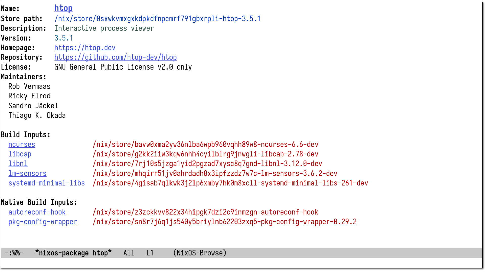

#+title: nixos.el - Browse NixOS options and packages
#+author: Daniel Nagy
#+language: en

nixos.el provides interactive =completing-read= and =tabulated-list-mode=
interfaces for browsing NixOS options and Nix packages from Emacs.

* Features

- Browse NixOS options and packages with =M-x nixos-option= / =nixos-package=
- Tabulated list views (=nixos-browse-options= / =nixos-browse-packages=) with Embark actions
- Sortable columns, version-aware package versions, and one group per
  top-level option attribute (=nixos-option-groups=)
- The package Version column grows to the longest visible version, so
  an unstable suffix stays readable, and entries without a version
  sort last
- Mouse support (middle button opens a row elsewhere, =mouse-3= menu)
  and export of the visible rows as Markdown (=e m=) or as a Nix list
  of =pkgs= attributes (=e n=)
- Local project evaluation (=nixos-package-local=) and tarball URLs (=nixos-package-url=)
- Org link types: =nixos-package:=, =nixos-option:=, =nixos-package-search:=, =nixos-option-search:=
  (opt-in module, enable with =(with-eval-after-load 'org (require 'ol-nixos))=)
- Evil bindings for the detail buffers and the tables (opt-in module,
  enable with =(with-eval-after-load 'evil (require 'evil-nixos))=)
- Detail buffers are =magit-section= trees: familiar fold and motion
  keys, a per-kind section hook you can reorder, and one section per
  flake output node
- Completion annotations, eldoc, and bookmark support

* Usage

After installing, use =M-x nixos-browse-options= or =M-x nixos-browse-packages=
to browse NixOS options and Nix packages.
Jump directly to a package with =M-x nixos-package=.

In a table buffer, =RET= opens the entry, =o= and =mouse-2= open it in
another window, =w= copies its name, =b= opens search.nixos.org, and =g=
reloads the table.  The =e= prefix exports the visible rows: =e m= writes a
Markdown table and =e n= writes a package table as a Nix list of =pkgs=
attributes.

The table shrinks its columns when the window is narrow, so the
description stays visible.  Use ={= and =}= to resize a column by hand;
a frame resize fits the columns again.

* Detail buffers

=M-x nixos-option=, =M-x nixos-package=, =M-x nixos-package-local=,
=M-x nixos-package-url= and =M-x nixos-flake= open a detail buffer.  The
buffer is a tree of =magit-section= sections, so it answers like a
Magit buffer: =TAB= folds the section at point, =n= and =p= move
between sections, =^= goes to the parent section, =1= to =4= show that
many levels, and the section at point highlights.  Every field line is a
section, and the input tree and the output list of a flake nest one
section per node.

Which sections appear is up to you.  Each buffer kind has its own hook,
and the entries run in order:

#+begin_src emacs-lisp
  (setopt nixos-package-sections-hook
          '(nixos-insert-package-title
            nixos-insert-package-fields))
#+end_src

The hooks are =nixos-option-sections-hook=,
=nixos-package-sections-hook=, =nixos-flake-sections-hook= and
=nixos-flake-overview-sections-hook=.  A refresh keeps the folded
sections and the line of point.

* Short display

The buffers shorten a long path and a long URL.  Both shortenings are
optional, and each one comes from another package.

A store path, a flake =Path:= and a source position go through
=tired-shorten-path= when the tired package is loaded.  Then a rule
in =tired-shorthand-rules= reaches the text in a detail buffer.

A URL and a forge flake reference go through =buffer-url-pretty-print=
when [[https://github.com/nagy/emacs-buffer-url][buffer-url]] is loaded.  Then a rule in =buffer-url-shorten-alist=
replaces a host name:

#+begin_src emacs-lisp
  (setopt buffer-url-shorten-alist
          '(("github.com/nagy/" . "nagy/")))
#+end_src

A =Homepage:= link, a flake =URL:= field, a =Flake:= reference and an
input source then show the short label.  The button action keeps the
real URL.

A forge reference expands first.  =github:owner/repo/rev= becomes
=https://github.com/owner/repo/tree/rev=, and GitLab and sourcehut
follow.  A reference with an unknown prefix stays as written.

Neither package is a dependency.  The buffers work without them and
show the full value.

* Evil

Opt in with:

#+begin_src emacs-lisp
  (with-eval-after-load 'evil (require 'evil-nixos))
#+end_src

A detail buffer and a table then start in the Evil normal state.  The
nixos commands keep their keys, and Evil's =g= prefix stays a prefix:

| Key   | Detail buffer                  | Table                    |
|-------+--------------------------------+--------------------------|
| =gr=  | refresh                        | refresh                  |
| =gb=  | open search.nixos.org          | open search.nixos.org    |
| =gR=  | show the requisites            |                          |
| =gd=  | visit the source position      |                          |
| =RET= | open the output (flake view)   | open the row             |
| =o=   |                                | open the row elsewhere   |
| =w=   | copy the store path            | copy the row name        |
| =e=   |                                | export the visible rows  |
| =TAB= | fold the section at point      |                          |
| ={= =}= |                              | resize a column          |

The keys =q=, =r= and =b= stay with Evil in a detail buffer, and =gg=,
=gf= and =gJ= keep their Evil meaning beside the nixos =g= keys.

* License

[[./LICENSE][AGPL3+]]
